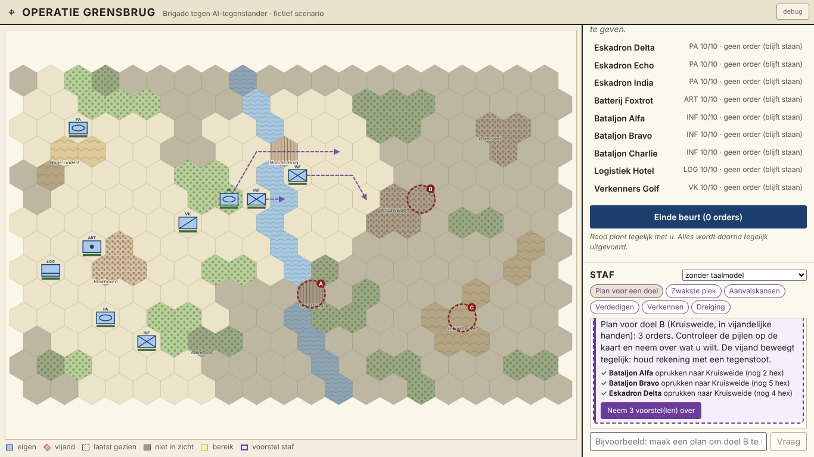
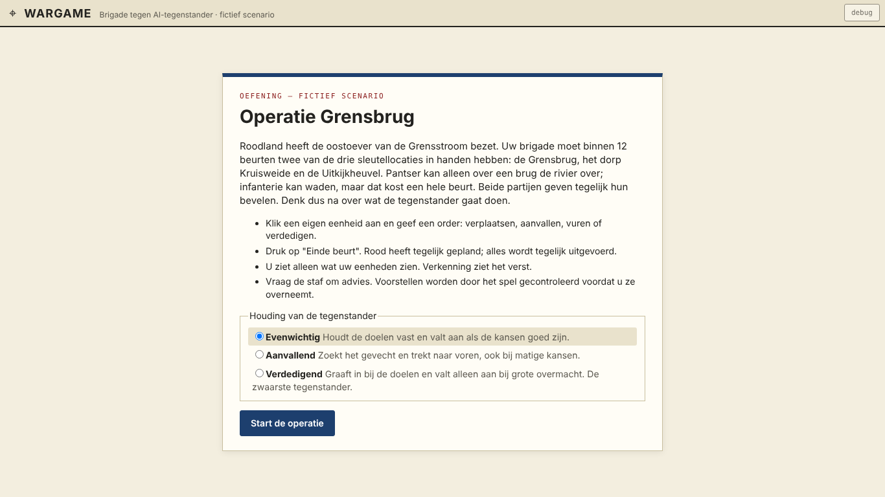
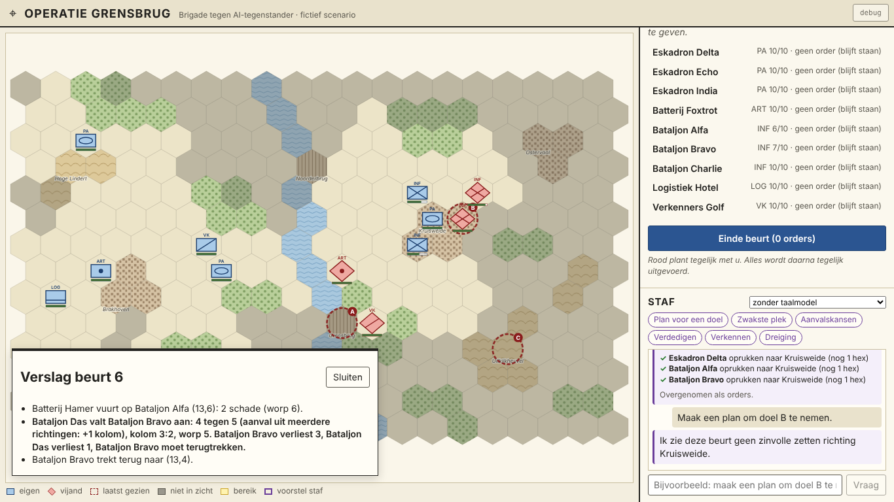
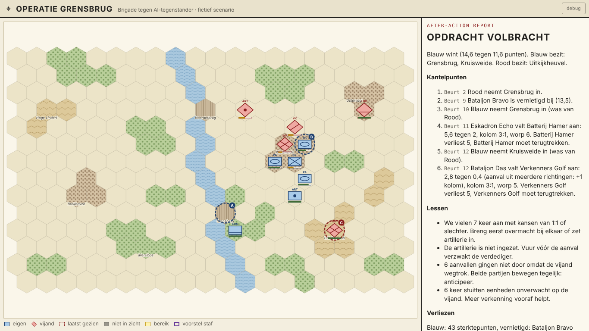

# Wargame: Operatie Grensbrug

Een wargame in de browser, in het Nederlands. U voert een blauwe brigade aan tegen een rode AI-tegenstander op een stafkaart met hexen, in een fictief land. Een AI-staf adviseert u. Een spel duurt 12 beurten, ongeveer 20 minuten.

**Het bijzondere:** beide partijen geven tegelijk hun bevelen. Daarna voert het spel alles tegelijk uit. U moet dus nadenken over wat de tegenstander gaat doen.

Het spel is gebouwd om **makkelijk en veilig aan te passen** door mensen die niet programmeren, met Claude Code. Zie [`docs/modding.md`](docs/modding.md) voor tien opdrachten om te plakken.



## Snel starten

Nodig: [Node.js](https://nodejs.org) 20.19 of nieuwer.

```bash
npm install
npm run dev
```

Open daarna http://localhost:5173. Er is geen `.env` of sleutel nodig: zonder sleutel werkt alles, alleen de staf "met taalmodel" staat dan uit.

## Hoe speel je?

1. Kies op het startscherm de houding van de tegenstander (evenwichtig, aanvallend of verdedigend) en start.
2. Klik op een eigen eenheid (blauwe rechthoek). Gele hexen kunt u bereiken. Klik op een gele hex om te verplaatsen, of op een vijand (rode ruit) om aan te vallen. Artillerie vuurt op zichtbare vijanden binnen 3 hexen.
3. Of vraag de staf: "Maak een plan om doel B te nemen". De staf tekent paarse pijlen; met één klik neemt u de voorstellen over. Het spel controleert elk voorstel.
4. Druk op **Einde beurt**. Rood plant tegelijk. Daarna ziet u in het beurtverslag wat er gebeurde.
5. Na 12 beurten volgt de uitslag met een after-action report: kantelpunten en lessen.

**Winnen:** punten voor elk doel dat u aan het eind bezit (Grensbrug 3, Kruisweide 4, Uitkijkheuvel 3), plus 0,2 punt per sterktepunt dat de vijand verloor. Wie 2 punten voor staat, wint. Anders is het onbeslist.

**Fog of war:** u ziet alleen wat uw eenheden zien. Verkenning kijkt het verst, en vanaf een heuvel ziet u over bos en stad heen. Gestippelde ruiten zijn vijanden die u eerder zag.

## De AI-staf

Er zijn twee modi, te kiezen in het stafpaneel:

- **Zonder taalmodel (standaard).** Snelle, eenvoudige analyse van wat u ziet, zonder internet. Werkt altijd.
- **Met taalmodel.** Stuurt een samenvatting van **alleen wat u ziet** naar een taalmodel via [OpenRouter](https://openrouter.ai). OpenRouter is een dienst die met één sleutel toegang geeft tot taalmodellen van verschillende makers (Anthropic, Google, OpenAI, …). U betaalt per gebruik.

Zo zet u het taalmodel aan:

```bash
cp .env.example .env
# vul OPENROUTER_API_KEY in (maak een sleutel op https://openrouter.ai/keys)
npm run dev
```

- **Standaardmodel:** `anthropic/claude-haiku-4.5`, in te stellen met `OPENROUTER_MODEL` in `.env`.
- **Kosten (schatting):** per vraag gaat er ongeveer 3.000 tokens heen (kaart, eenheden, vraag) en komen er ongeveer 500 terug. Tegen ongeveer $1 per miljoen tokens invoer en $5 per miljoen uitvoer is dat ongeveer **$0,006 per vraag**. Met 15 vragen kost een spel dus ongeveer **$0,10**. De prijzen zijn opgezocht op het moment van bouwen; controleer de actuele prijs op openrouter.ai.
- **De sleutel staat alleen in `.env` op de server** (`packages/server`), nooit in de browser en nooit in git.
- **Het model kan niet valsspelen.** Het ziet alleen het spelersbeeld, en elk voorstel gaat door de controle van het spel. Een onmogelijke zet wordt geweigerd, met de reden erbij.

## Commando's

| Commando                                        | Wat                                                                                  |
| ----------------------------------------------- | ------------------------------------------------------------------------------------ |
| `npm run dev`                                   | Spel (poort 5173) en staf-server (poort 8787) starten                                |
| `npm run dev:web`                               | Alleen het spel                                                                      |
| `npm test`                                      | Alle tests (Vitest), ongeveer 3 seconden                                             |
| `npm run test:watch`                            | Tests opnieuw draaien bij elke wijziging                                             |
| `npm run test:e2e`                              | Playwright speelt een volledig spel in de browser                                    |
| `npm run typecheck`                             | TypeScript-controle                                                                  |
| `npm run lint`                                  | ESLint (bewaakt ook de architectuurregels)                                           |
| `npm run build`                                 | Statische site in `packages/web/dist` (bijvoorbeeld voor Cloudflare Pages of Vercel) |
| `npx tsx packages/engine/scripts/balance.ts 40` | Balans meten: computer tegen computer over 40 seeds                                  |

Een spel naspelen met dezelfde dobbelstenen: `http://localhost:5173/?seed=42`. In development is er rechtsboven een **debug**-knop: scenario laden, naar een beurt springen, fog of war uit.

## Hoe zit het in elkaar?

```
packages/
  engine/   Spelregels als pure TypeScript: applyAction(toestand, actie) → nieuwe toestand.
            src/data/      eenheden, terrein, gevechtstabel, AI-houdingen, scenario's (hier pas je het meest aan)
            src/rules/     beweging, zicht, gevecht, uitvoeren van een beurt, uitslag
            src/ai/        de AI-tegenstander (regelgebaseerd, deterministisch)
            src/staff/     de AI-staf: commando's, controle van voorstellen, prompt voor het taalmodel
  web/      React + Vite. Tekent de kaart en stuurt acties; bevat geen spelregels.
  server/   Express-doorgeefluik naar OpenRouter (optioneel).
docs/       modding-gids, besluiten, logboek, ideeën, screenshots
```

Belangrijkste afspraken (uitgebreid in [`CLAUDE.md`](CLAUDE.md)):

- Spelregels alleen in de engine.
- Toeval alleen uit de geseede generator: zelfde seed en acties geven hetzelfde spel.
- Iedereen (kaart, AI-tegenstander, staf) krijgt alleen het spelersbeeld met fog of war.
- Data in `src/data/`: een nieuw eenheidstype of terrein toevoegen vraagt geen code elders.

Besluiten en achtergrond: [`docs/BESLISSINGEN.md`](docs/BESLISSINGEN.md). Logboek: [`docs/LOGBOEK.md`](docs/LOGBOEK.md). Ideeën voor later: [`docs/ideeen.md`](docs/ideeen.md).

## Alles is fictief

Land, plaatsen, eenheden en getallen zijn verzonnen en vereenvoudigd. Ze verwijzen niet naar echte landen, eenheden, wapensystemen of operaties.

## Screenshots

| Start                              | Beurtverslag met gevecht             | After-action report                              |
| ---------------------------------- | ------------------------------------ | ------------------------------------------------ |
|  |  |  |
